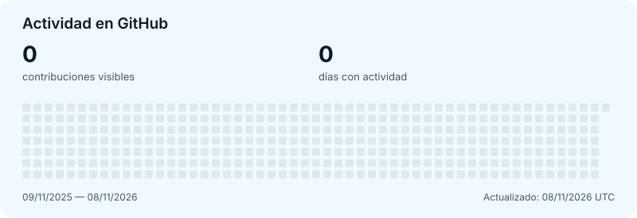

  

  
  &nbsp;
  
  &nbsp;
  

  

## Tecnología con identidad. Negocios con visión.

Soy **Xavi**, desarrollador full stack especializado en **blockchain y ecommerce**. Desde **NusaKa**, desarrollo soluciones a medida que conectan la experiencia del cliente con la operativa del negocio: una web con identidad propia y las herramientas necesarias para gestionarla desde dentro.

Mi enfoque une **diseño, desarrollo y SEO** con un **CRM y un panel de gestión integrados**. El objetivo es que tu tienda sea tan fácil de administrar como de utilizar, con una base técnica que permita adaptarla a medida que crece tu negocio.

### Tu tienda tiene más que ofrecer

¿Tienes una tienda en **Shopify** y sientes que le falta personalidad, que la personalización se queda corta o que no consigue la visibilidad que buscas en Google?

**Desarrollo la solución que necesitas para dar el siguiente paso:** una experiencia de compra a medida, una estructura pensada para el posicionamiento SEO y una gestión integrada de la web y de la relación con tus clientes. Cada decisión parte de lo que necesita tu negocio, desde cómo se presenta hasta cómo trabaja por dentro.

### En qué me especializo

- **Ecommerce a medida:** tiendas con identidad, navegación cuidada y una experiencia de compra diseñada para tu marca.
- **CRM y gestión web:** herramientas integradas para organizar la relación con tus clientes y administrar tu tienda desde un mismo entorno.
- **SEO técnico:** rendimiento, estructura y accesibilidad como base para que tus productos puedan encontrarse.
- **Soluciones blockchain:** desarrollo full stack para aplicaciones que necesitan integrar tecnología blockchain.

  
<strong>Mi actividad en GitHub</strong>

   

  

    <picture>
      <source media="(prefers-color-scheme: dark)" srcset="assets/activity-dark.svg" />
      
    </picture>
  

  La mayor parte de mi trabajo está en repositorios privados. Este resumen muestra únicamente la actividad que GitHub hace visible en mi perfil.

  [Ver mi actividad en GitHub →](https://github.com/tricoma035?tab=overview)

---

  <em>Que lo que hoy imaginas encuentre mañana su lugar en el mundo.</em>

  

